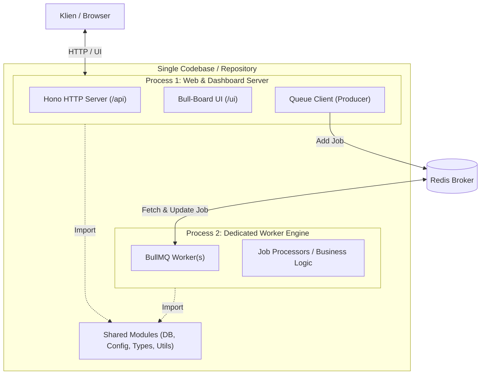

# Arsitektur Qentral (Single Codebase, Multi-Process)

Dokumentasi ini menjelaskan rancangan arsitektur untuk **Qentral** — sistem pemrosesan job (*background task*) terpusat menggunakan pola **Modular Monolith (Single Codebase, Multi-Process)**.

Pendekatan ini menyatukan seluruh kode ke dalam **satu repository**, namun memisahkan proses runtime antara **Web API + Dashboard** dan **Worker Pemroses**.

---

## 1. Ikhtisar Arsitektur



### Mengapa Pendekatan Ini?
1. **Satu Repositori (Mudah Dikelola)**: Menghindari kerumitan repositori terpisah (*micro-repos*), mempermudah refactoring, dan mempercepat proses pengembangan.
2. **Isolasi Beban Kerja (Resource Isolation)**: Tugas komputasi berat pada *Worker* tidak akan memblokir *Event Loop* server HTTP Hono. Respons API ke pengguna tetap cepat dan stabil.
3. **Pencegahan Efek Domino (Fault Tolerance)**: Jika *Worker* mengalami kegagalan fatal (*Out of Memory* / unhandled exception), server API dan Dashboard tetap aktif.
4. **Skalabilitas Fleksibel**: Anda dapat menjalankan 1 instans Web Server dan 4 instans Worker secara independen sesuai kapasitas CPU.

---

## 2. Struktur Direktori Proyek

```text
qentral/
├── src/
│   ├── config/
│   │   └── redis.ts           # Konfigurasi koneksi Redis
│   ├── queues/
│   │   ├── index.ts           # Registrasi semua antrean (QueueMQ)
│   │   └── email.queue.ts     # Definisi antrean spesifik (misal: Email)
│   ├── workers/
│   │   ├── index.ts           # Runner utama pengumpul semua worker
│   │   └── email.worker.ts    # Logika eksekusi job (processor)
│   ├── api/
│   │   ├── index.ts           # Sub-aplikasi route API Hono
│   │   └── routes/            # Route endpoint aplikasi
│   ├── dashboard/
│   │   └── index.ts           # Inisialisasi adapter Bull-Board
│   ├── shared/
│   │   ├── types.ts           # Type definitions & Job payload interface
│   │   ├── db.ts              # Koneksi Database (Prisma / Drizzle / dll)
│   │   └── logger.ts          # Logger terpusat
│   ├── server.ts              # Entrypoint 1: HTTP API + Bull-Board
│   └── worker.ts              # Entrypoint 2: Background Worker Engine
├── ecosystem.config.js        # Konfigurasi PM2 untuk production
├── package.json
├── tsconfig.json
└── README.md
```

---

## 3. Komponen Utama & Pembagian Peran

### A. Entrypoint 1: Web & Dashboard (`src/server.ts`)
* **Tanggung Jawab**:
  * Melayani request HTTP REST API via Hono.
  * Mendaftarkan antrean ke Bull-Board UI pada path `/ui`.
  * Memasukkan data pekerjaan (*producer*) ke Redis via `queue.add()`.
* **Karakteristik**: Berjalan terus menerus, fokus pada kecepatan respons I/O, tidak melakukan komputasi berat.

### B. Entrypoint 2: Worker Engine (`src/worker.ts`)
* **Tanggung Jawab**:
  * Menginisialisasi `new Worker(...)` dari BullMQ.
  * Menarik (*polling/event-driven*) job dari Redis dan mengeksekusi logika bisnisnya.
  * Mengirim status progres (`job.updateProgress`) dan log (`job.log`).
  * Menangani mekanisme *retry* dan *dead-letter*.
* **Karakteristik**: Bisa di-scale menjadi beberapa proses (clustering) sesuai jumlah core server.

### C. Shared Modules (`src/shared/`)
* Digunakan bersama oleh `server.ts` dan `worker.ts`.
* Berisi skema payload data job (TypeScript types), helper validasi, dan koneksi database.

---

## 4. Standar Kontrak Job (*Job Contract*)

Setiap job dianjurkan menggunakan format payload yang konsisten:

```typescript
export interface BaseJobPayload<T = unknown> {
  traceId: string;       // ID pelacakan lintas log
  requestedBy: string;   // Siapa yang memicu (userId / system / cron)
  timestamp: string;     // Waktu pemicu dibuat
  data: T;               // Data payload spesifik
}
```

---

## 5. Cara Pengguna Mem-publish Job (*Integration Guide*)

Sebagai sistem terpusat, proyek ini menyediakan antarmuka bagi layanan luar (klien) untuk memasukkan pekerjaan ke antrean.

### A. Melalui HTTP REST API Gateway (Universal / Multi-Bahasa)
Layanan dari bahasa atau framework apa pun (PHP, Python, Go, Frontend) cukup mengirimkan HTTP `POST` request ke server Hono.

#### 1. Publish Job Baru
* **Endpoint**: `POST /api/v1/jobs/:queueName`
* **Headers**:
  * `Content-Type: application/json`
  * `x-api-key: <TOKEN_RAHASIA>`
* **Request Body**:
  ```json
  {
    "jobName": "send-welcome-email",
    "data": {
      "to": "user@example.com",
      "subject": "Selamat Datang!",
      "templateId": "tpl_01"
    },
    "options": {
      "attempts": 3,
      "delay": 5000,
      "priority": 1
    }
  }
  ```
* **Contoh Pemanggilan (`cURL`)**:
  ```bash
  curl -X POST http://localhost:3000/api/v1/jobs/email-queue \
    -H "Content-Type: application/json" \
    -H "x-api-key: secret-key-anda" \
    -d '{
      "jobName": "send-welcome-email",
      "data": { "to": "user@example.com" }
    }'
  ```
* **Response (HTTP 202 Accepted)**:
  ```json
  {
    "success": true,
    "message": "Job berhasil dimasukkan ke antrean",
    "queue": "email-queue",
    "jobId": "142"
  }
  ```

#### 2. Cek Status Job (Polling Status)
Klien yang memegang `jobId` dapat memeriksa progres atau status eksekusi job kapan saja:
* **Endpoint**: `GET /api/v1/jobs/:queueName/:jobId`
* **Response (HTTP 200 OK)**:
  ```json
  {
    "id": "142",
    "state": "completed",
    "progress": 100,
    "result": { "sentAt": "2026-10-20T18:00:00Z" },
    "failedReason": null
  }
  ```
  *(Nilai `state`: `waiting` | `active` | `completed` | `failed` | `delayed`)*

#### 3. Manajemen Jadwal Berulang (Repeatable / Cron Jobs)
Klien dapat melihat dan menghapus jadwal berulang secara programatik via HTTP API:
* **Daftar Jadwal**: `GET /api/v1/jobs/:queueName/repeatable`
  * Response: `{ success: true, queue: string, data: RepeatableJobInfo[] }`
* **Hapus Jadwal**: `DELETE /api/v1/jobs/:queueName/repeatable/:repeatKey`
  * Response: `{ success: true, message: string, removed: boolean }`

---

### B. Melalui Akses Redis Langsung (Khusus Service Internal Node.js / Bun)
Jika aplikasi klien berada dalam jaringan lokal yang sama dan menggunakan Node.js/Bun, klien dapat langsung mengimpor `Queue` BullMQ tanpa melewati HTTP:

```typescript
import { Queue } from 'bullmq';

const emailQueue = new Queue('email-queue', {
  connection: { host: 'redis-server', port: 6379 }
});

await emailQueue.add('send-welcome-email', { to: 'user@example.com' });
```

---

## 6. Menjalankan Aplikasi (Lingkungan Bun)

Proyek ini dirancang menggunakan runtime **Bun**:

### A. Pengaturan di `package.json`

```json
{
  "name": "qentral",
  "scripts": {
    "dev:web": "bun --watch src/server.ts",
    "dev:worker": "bun --watch src/worker.ts",
    "start:web": "bun src/server.ts",
    "start:worker": "bun src/worker.ts"
  }
}
```

* **Mode Development**:
  Jalankan dua terminal terpisah:
  - Terminal 1: `bun run dev:web` (HTTP API & Bull-Board UI)
  - Terminal 2: `bun run dev:worker` (Worker Engine pemroses job)

---

## 7. Deployment & Orkestrasi di Lingkungan Produksi (Tanpa Docker)

Untuk menjalankan kedua proses di server produksi (VPS / Bare Metal Linux) menggunakan **PM2**:

```javascript
// ecosystem.config.js
module.exports = {
  apps: [
    {
      name: 'job-api-web',
      script: 'src/server.ts',
      interpreter: 'bun',
      instances: 1,
      autorestart: true,
      env: {
        NODE_ENV: 'production',
        PORT: 3000
      }
    },
    {
      name: 'job-worker',
      script: 'src/worker.ts',
      interpreter: 'bun',
      instances: 2, // Scale worker sesuai core CPU
      autorestart: true,
      env: {
        NODE_ENV: 'production'
      }
    }
  ]
};
```

Perintah eksekusi:
```bash
pm2 start ecosystem.config.js
pm2 save
pm2 startup
```

---

## 8. Prinsip Keandalan (*Reliability Best Practices*)

1. **Graceful Shutdown**:
   Pada `src/worker.ts`, wajib menangani sinyal `SIGINT` dan `SIGTERM` agar worker menyelesaikan job aktif sebelum proses mati:
   ```typescript
   process.on('SIGTERM', async () => {
     await worker.close();
     process.exit(0);
   });
   ```
2. **Idempotensi**:
   Desain pemrosesan job agar aman dijalankan ulang (*re-run*) jika terjadi kegagalan jaringan di tengah proses.
3. **Proteksi Dashboard UI**:
   Pada `src/server.ts`, pasang middleware otentikasi (misalnya Basic Auth atau JWT Auth) pada route `/ui` agar dashboard tidak terbuka untuk publik.
